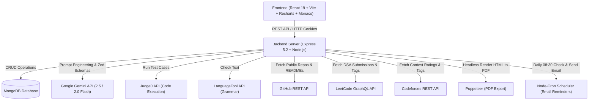

# SkillMirror — AI-Powered Technical Interview & Resume Platform

<div align="center">


<br/>

[](https://react.dev/)
[](https://vitejs.dev/)
[](https://expressjs.com/)
[](https://www.mongodb.com/)
[](https://ai.google.dev/)
[](https://pptr.dev/)
[](https://opensource.org/licenses/ISC)

<p align="center">
  <strong>SkillMirror</strong> is an all-in-one AI career coaching and interview preparation ecosystem. By analyzing your resume, target job descriptions, and real-world developer profiles (GitHub, LeetCode, Codeforces), SkillMirror creates hyper-targeted technical and behavioral interview preparation plans, provides voice simulation with real-time feedback, conducts live code execution, evaluates STAR-method answers, checks grammar, performs ATS score benchmarking, and automates interview reminder scheduling.
</p>

</div>

---

## 📑 Table of Contents

- [Key Features](#-key-features)
- [System Architecture](#-system-architecture)
- [Tech Stack](#-tech-stack)
- [Folder Structure](#-folder-structure)
- [External Integrations & APIs](#-external-integrations--apis)
- [Getting Started](#-getting-started)
  - [Prerequisites](#prerequisites)
  - [Environment Variables Setup](#environment-variables-setup)
  - [Installation & Running Locally](#installation--running-locally)
- [API Reference](#-api-reference)
  - [Authentication (`/api/auth`)](#authentication-endpoints)
  - [Interview & AI Coaching (`/api/interview`)](#interview-endpoints)
  - [Resume & ATS Management (`/api/resume`)](#resume--ats-endpoints)
  - [Developer Integrations (`/api`)](#developer-integration-endpoints)
- [Core Workflows & Modules](#-core-workflows--modules)
  - [1. AI Interview Plan Generation](#1-ai-interview-plan-generation)
  - [2. Multi-Platform Developer Profiling](#2-multi-platform-developer-profiling)
  - [3. Voice Interview Simulation](#3-voice-interview-simulation)
  - [4. In-Browser Live Code Runner](#4-in-browser-live-code-runner)
  - [5. STAR Method & Grammar Assessment](#5-star-method--grammar-assessment)
  - [6. ATS Score Checker & JD Gap Analysis](#6-ats-score-checker--jd-gap-analysis)
  - [7. Mentor Collaboration & Public Sharing](#7-mentor-collaboration--public-sharing)
  - [8. Automated Email Reminders](#8-automated-email-reminders)
  - [9. High-Fidelity PDF Export](#9-high-fidelity-pdf-export)
- [Troubleshooting & FAQs](#-troubleshooting--faqs)
- [Contributing & License](#-contributing--license)

---

## ✨ Key Features

### 🧠 AI-Powered Interview Intelligence
- **Resume & Job Matching**: Upload a PDF resume (up to 5MB) or enter text; Gemini AI calculates role match scores and overall readiness.
- **Role & Company Alignment**: Tailor prep questions to specific companies (e.g. Amazon Leadership Principles, Google system design).
- **Multi-Language Generation**: Generate questions, model answers, intentions, and roadmaps in **English**, **Hindi**, or **Hinglish**.
- **Structured Roadmap**: 5-day customized daily preparation schedule focusing on critical gap closures.
- **Adaptive Question Engine**: Dynamically fetch harder or easier follow-up questions in real time based on candidate scoring performance.

### 🌐 Multi-Platform Developer Profiling
- **GitHub Sync**: Ingests public repositories, stars, top languages, and README summaries to formulate questions on real codebases and architecture choices.
- **LeetCode Sync**: Analyzes solved problem counts (Easy/Medium/Hard) and problem-tag distributions to balance DSA practice and probe weak areas.
- **Codeforces Sync**: Pulls contest rating, max rating, ranking, and topic breakdown to assess competitive programming depth.

### 🎙️ Voice & Interactive Practice
- **Voice Interview Simulator**: Uses Web Speech API (Speech Recognition + Speech Synthesis) to read questions aloud and capture candidate spoken responses.
- **Speech Analytics**: Evaluates answer clarity, structure, concrete improvement tips, and automatic filler word detection (`"um"`, `"uh"`, `"like"`, `"you know"`, `"basically"`, `"actually"`).
- **STAR Framework Evaluator**: Validates behavioral answers against **Situation, Task, Action, Result** components.
- **In-Browser Code Execution**: Write and execute algorithms in JavaScript, Python 3, or Java directly inside a **Monaco Editor** against question test cases via Judge0.
- **Real-Time Grammar Assistant**: Integrated LanguageTool checks text answers for grammar, tone, and readability.

### 📄 Resume Management & ATS Optimization
- **Resume Library**: Save and manage multiple versions of your resume in MongoDB.
- **Detailed ATS Score Checker**: Generates an overall ATS score alongside breakdown metrics (Keyword Match, Formatting, Achievements, Action Verbs, Section Completeness) and missing keyword lists.
- **Resume-to-JD Gap Analysis**: Categorizes skills into *Already Have*, *Add to Resume*, and *Need to Learn* with actionable recommendations.

### 👥 Collaboration & Productivity
- **Mentor Share Links**: Generate unique public share links (`/shared/:shareToken`) allowing mentors or peers to review reports without authentication.
- **Interactive Mentor Comments**: Mentors can post feedback and discussion notes on shared reports.
- **Automated Email Reminders**: `node-cron` scheduler with `nodemailer` dispatches interview reminder emails 3 days before scheduled interview dates.
- **PDF Generation**: Generates high-fidelity, beautifully styled PDFs for resumes and preparation plans via headless Puppeteer.
- **Analytics Dashboard**: Tracks interview score progression over time with interactive Recharts visualizations.
- **Dark / Light Mode**: Seamless theme switching with context persistence.

---

## 🏗️ System Architecture



---

## 💻 Tech Stack

### Frontend
- **Framework**: React 19.2 (React DOM 19.2)
- **Build Tool**: Vite 8.0
- **Routing**: React Router v7
- **Code Editor**: `@monaco-editor/react` & `monaco-editor` 0.56
- **Data Visualization**: Recharts 2.6 (RadialBarChart, LineChart, PieChart)
- **Styling**: Vanilla SASS / SCSS with custom design token system
- **HTTP Client**: Axios 1.15
- **Typography**: `@fontsource/inter`

### Backend
- **Runtime**: Node.js
- **Framework**: Express.js 5.2
- **Database**: MongoDB with Mongoose 9.4
- **AI Engine**: `@google/genai` 2.0 (Gemini 2.5 Flash / 2.0 Flash / 1.5 Pro) with Zod validation
- **PDF Generation & Parsing**: Puppeteer 24.4 & `pdf-parse` 2.4
- **Authentication**: JWT (`jsonwebtoken` 9.0) stored in `httpOnly` secure cookies + `bcryptjs`
- **File Handling**: Multer 2.1 (in-memory buffer parsing)
- **Background Tasks**: `node-cron` 3.0
- **Email Delivery**: Nodemailer 6.10 (SMTP)
- **Validation**: Zod 4.4 + `zod-to-json-schema`

---

## 📂 Folder Structure

```
ResumeMaker/
├── Backend/
│   ├── src/
│   │   ├── config/
│   │   │   └── database.js              # MongoDB connection setup
│   │   ├── controllers/
│   │   │   ├── ats.controller.js        # ATS scoring & breakdown handlers
│   │   │   ├── auth.controller.js       # Register, login, logout, getMe handlers
│   │   │   ├── integration.controller.js# GitHub, LeetCode, Codeforces proxy handlers
│   │   │   ├── interview.controller.js  # Core report generation, voice, STAR, code execution
│   │   │   └── resume.controller.js     # Resume upload & listing handlers
│   │   ├── jobs/
│   │   │   └── reminder.job.js          # Cron job for 3-day interview email reminders
│   │   ├── middlewares/
│   │   │   ├── auth.middleware.js       # JWT cookie verification & token blacklist check
│   │   │   └── file.middleware.js       # Multer 5MB PDF upload filter
│   │   ├── models/
│   │   │   ├── ats.model.js             # ATS score records schema
│   │   │   ├── blacklist.model.js       # Blacklisted JWT tokens schema
│   │   │   ├── interviewReport.model.js # Full interview report schema
│   │   │   ├── resume.model.js          # Uploaded resume schema
│   │   │   └── user.model.js            # User credentials schema
│   │   ├── routes/
│   │   │   ├── auth.routes.js           # /api/auth routes
│   │   │   ├── integration.routes.js    # /api developer profile sync routes
│   │   │   ├── interview.routes.js      # /api/interview routes
│   │   │   └── resume.routes.js         # /api/resume routes
│   │   ├── services/
│   │   │   ├── ai.service.js            # Gemini AI prompt engineering & schema validation
│   │   │   ├── codeExecution.service.js # Judge0 live code execution service
│   │   │   ├── codeforces.service.js    # Codeforces API integration
│   │   │   ├── github.service.js        # GitHub REST API & README fetcher
│   │   │   ├── grammar.service.js       # LanguageTool grammar checker service
│   │   │   ├── leetcode.service.js      # LeetCode GraphQL API scraper
│   │   │   ├── pdfExport.service.js     # Puppeteer PDF export service
│   │   │   └── resumeTemplate.js        # HTML template builder for PDF resume
│   │   ├── utils/
│   │   │   └── pdf.util.js              # PDF text extraction utility (pdf-parse)
│   │   └── app.js                       # Express application & CORS middleware
│   ├── .env.example                     # Backend environment variables template
│   ├── package.json                     # Backend dependencies & scripts
│   └── server.js                        # Server entry point & scheduler initiator
│
├── Frontend/
│   ├── src/
│   │   ├── components/
│   │   │   ├── ui/                      # Reusable UI library (Button, Modal, Toast, Card, etc.)
│   │   │   └── AppNavbar.jsx            # Sticky global navigation & theme toggle
│   │   ├── features/
│   │   │   ├── about/                   # About page
│   │   │   ├── auth/                    # Login, Register, Protected routes & Auth Context
│   │   │   ├── dashboard/               # Progress Dashboard & Readiness charts
│   │   │   ├── interview/               # Home, Interview Report, Voice Simulation, CodeRunner,
│   │   │   │                            # STAR Checker, Gap Analysis, Shared Report
│   │   │   ├── resume/                  # ATS Score Checker & Resume Library
│   │   │   └── theme/                   # Dark/Light theme state & toggle
│   │   ├── styles/                      # Design system tokens & global SCSS
│   │   ├── App.jsx                      # App root component
│   │   ├── app.routes.jsx               # React Router route definitions
│   │   └── main.jsx                     # Vite DOM mount entry point
│   ├── .env.example                     # Frontend environment variables template
│   ├── index.html                       # HTML5 template
│   ├── package.json                     # Frontend dependencies & scripts
│   └── vite.config.js                   # Vite configuration
│
└── README.md                            # Comprehensive project documentation
```

---

## 🔌 External Integrations & APIs

| Service | Purpose | Authentication / Config | Fallback Behavior |
|---|---|---|---|
| **Google Gemini** | Report generation, STAR analysis, Voice feedback, Gap analysis | `GOOGLE_API_KEY` in `Backend/.env` | Automatic fallback through `gemini-2.5-flash`, `2.0-flash`, `1.5-flash`, `1.5-pro` |
| **GitHub REST API** | Fetches user repos, stars, languages & READMEs | Optional `GITHUB_TOKEN` (increases rate limit 60 &rarr; 5000 req/hr) | Non-blocking; gracefully proceeds with resume data only if unavailable |
| **LeetCode GraphQL API** | Solved count by difficulty & top tag distribution | Public endpoint | Retries up to 2 times; non-blocking fallback |
| **Codeforces API** | User rating, rank, total solved, and tag counts | Public endpoint | Retries up to 2 times; non-blocking fallback |
| **Judge0 API** | Executes JavaScript, Python, and Java against test cases | `JUDGE0_API_KEY` (RapidAPI) | Returns friendly error message prompting configuration |
| **LanguageTool API** | Grammar and spelling analysis | Optional `LANGUAGETOOL_API_KEY` (public tier supported) | Graceful fallback returning empty issue list |
| **Puppeteer** | Server-side PDF generation from HTML templates | Local Chromium instance | Throws actionable error with status code |
| **SMTP / Nodemailer** | Dispatches interview preparation reminders | `SMTP_HOST`, `SMTP_PORT`, `SMTP_USER`, `SMTP_PASS` | Logs error without crashing server |

---

## 🚀 Getting Started

### Prerequisites

- **Node.js**: v18.0.0 or higher
- **npm**: v9.0.0 or higher
- **MongoDB**: Local MongoDB instance (`mongodb://localhost:27017`) or [MongoDB Atlas](https://www.mongodb.com/atlas) connection string
- **Google Gemini API Key**: Obtain a free API key from [Google AI Studio](https://aistudio.google.com/app/apikey)

---

### Environment Variables Setup

#### 1. Backend Configuration (`Backend/.env`)

Create a `.env` file in the `Backend/` directory:

```env
# Server Configuration
PORT=3000

# MongoDB Connection
MONGO_URI=mongodb+srv://<username>:<password>@cluster.mongodb.net/skillmirror?retryWrites=true&w=majority

# JWT Authentication
JWT_SECRET=your_super_secret_jwt_key_here

# Google Generative AI (Gemini)
GOOGLE_API_KEY=your_google_ai_studio_api_key
# Optional model override (defaults to gemini-2.5-flash)
# GEMINI_MODEL=gemini-2.5-flash

# GitHub API (Optional: increases rate limits from 60 to 5000 req/hr)
GITHUB_TOKEN=your_github_personal_access_token

# Judge0 Code Execution API (Optional: RapidAPI)
JUDGE0_API_KEY=your_rapidapi_judge0_key
JUDGE0_API_URL=https://judge0-ce.p.rapidapi.com

# LanguageTool Grammar Check (Optional)
LANGUAGETOOL_API_KEY=your_languagetool_key

# SMTP Configuration for Email Reminders
SMTP_HOST=smtp.gmail.com
SMTP_PORT=587
SMTP_USER=your_email@gmail.com
SMTP_PASS=your_email_app_password
EMAIL_FROM="SkillMirror <no-reply@skillmirror.com>"

# Frontend URL (CORS & Email Links)
FRONTEND_URL=http://localhost:5173
```

#### 2. Frontend Configuration (`Frontend/.env`)

Create a `.env` file in the `Frontend/` directory:

```env
# Backend API Base URL
VITE_API_URL=http://localhost:3000
```

---

### Installation & Running Locally

#### Step 1: Clone the repository
```bash
git clone https://github.com/Sarthak92101/ResumeBuilder.git
cd ResumeBuilder
```

#### Step 2: Install Backend Dependencies & Start Server
```bash
cd Backend
npm install
npm run dev
```
> The backend server starts on **http://localhost:3000** and connects to MongoDB. The daily reminder scheduler initializes automatically.

#### Step 3: Install Frontend Dependencies & Start Dev Client
Open a new terminal tab:
```bash
cd Frontend
npm install
npm run dev
```
> The frontend development server starts on **http://localhost:5173**.

---

## 📚 API Reference

### Authentication Endpoints

Base URL: `/api/auth`

| Method | Endpoint | Description | Auth Required | Request Body / Params |
|---|---|---|---|---|
| `POST` | `/register` | Create a new user account | ❌ No | `{ "username": "...", "email": "...", "password": "..." }` |
| `POST` | `/login` | Authenticate and set `token` cookie | ❌ No | `{ "email": "...", "password": "..." }` |
| `GET` | `/logout` | Blacklist token and clear session cookie | ❌ No | None |
| `GET` | `/me` | Retrieve profile of authenticated user | ✅ Yes | None |

---

### Interview Endpoints

Base URL: `/api/interview`

| Method | Endpoint | Description | Auth Required | Payload / Parameters |
|---|---|---|---|---|
| `POST` | `/` | Generate complete interview report | ✅ Yes | `multipart/form-data` or JSON with `jobDescription`, `resume` (file), `selfDescription`, `targetCompany`, `interviewDate`, `language`, `githubUsername`, `leetcodeUsername`, `codeforcesHandle` |
| `GET` | `/` | Retrieve all interview reports for user | ✅ Yes | None |
| `GET` | `/report/:interviewId` | Retrieve single interview report by ID | ✅ Yes | `interviewId` (path param) |
| `GET` | `/report/:interviewId/pdf` | Download report as PDF (`type=plan` or `type=resume`) | ✅ Yes | Query: `?type=plan` or `?type=resume` |
| `GET` | `/stats` | Get historical readiness scores & averages | ✅ Yes | None |
| `POST` | `/ats-score` | Calculate quick ATS match score | ✅ Yes | `{ "resumeText": "...", "jobDescription": "...", "targetCompany": "..." }` |
| `POST` | `/star-check` | Validate answer against STAR framework | ✅ Yes | `{ "questionText": "...", "userAnswer": "..." }` |
| `POST` | `/voice-feedback` | Analyze voice transcript for clarity & filler words | ✅ Yes | `{ "questionText": "...", "transcript": "..." }` |
| `POST` | `/gap-analysis` | Perform Resume vs JD gap categorization | ✅ Yes | `{ "resumeId": "..." or "resumeText": "...", "jobDescription": "..." }` |
| `POST` | `/next-question` | Generate adaptive next question based on score | ✅ Yes | `{ "runningScore": 75, "previousQuestions": [...], "resumeText": "...", "jobDescription": "..." }` |
| `POST` | `/run-code` | Execute code against question test cases via Judge0 | ✅ Yes | `{ "code": "...", "language": "javascript|python|java", "questionId": "..." }` |
| `POST` | `/grammar-check` | Check spelling and grammar via LanguageTool | ✅ Yes | `{ "text": "..." }` |
| `POST` | `/report/:interviewId/share` | Generate unique public share token | ✅ Yes | `interviewId` (path param) |
| `GET` | `/shared/:shareToken` | Retrieve public report view | ❌ Public | `shareToken` (path param) |
| `POST` | `/shared/:shareToken/comment` | Add mentor feedback comment | ❌ Public | `{ "author": "...", "text": "..." }` |

---

### Resume & ATS Endpoints

Base URL: `/api/resume`

| Method | Endpoint | Description | Auth Required | Payload |
|---|---|---|---|---|
| `POST` | `/` | Upload and parse new resume PDF | ✅ Yes | `multipart/form-data` with `resume` (PDF file) |
| `GET` | `/` | List all uploaded resumes for user | ✅ Yes | None |
| `POST` | `/ats-score` | Create detailed ATS score and breakdown | ✅ Yes | `{ "resumeId": "...", "jobDescription": "..." }` |
| `GET` | `/ats-score/:resumeId` | Get past ATS score records for a resume | ✅ Yes | `resumeId` (path param) |

---

### Developer Integration Endpoints

Base URL: `/api`

| Method | Endpoint | Description | Auth Required |
|---|---|---|---|
| `GET` | `/github/:username` | Fetch GitHub user repos, stars, languages, and README summaries | ✅ Yes |
| `GET` | `/leetcode/:username` | Fetch LeetCode solved counts by difficulty and top problem tags | ✅ Yes |
| `GET` | `/codeforces/:handle` | Fetch Codeforces rating, rank, total solved, and tag stats | ✅ Yes |

---

## 🎯 Core Workflows & Modules

### 1. AI Interview Plan Generation
When generating an interview report, SkillMirror passes the candidate's resume, job description, target company, language selection, and developer profiles into Google Gemini with structured Zod schemas:
- **Match Score & Readiness Score (0-100)**: Quantitative indicator of resume-to-job fit.
- **5 Technical Questions**: Each tagged with difficulty (Easy, Medium, Hard), interviewer intention, and model answer. For algorithmic questions, `isCoding` is flagged with 2-3 structured test cases (input & expected output).
- **5 Behavioral Questions**: Tailored to target company principles and work history.
- **Skill Gaps**: Rated as `low`, `medium`, or `high` severity.
- **5-Day Preparation Roadmap**: Step-by-step daily milestones with actionable tasks.

### 2. Multi-Platform Developer Profiling
- **GitHub Integration**: Fetches the candidate's recent public repositories, inspects repository READMEs, and asks at least 2 architecture/decision questions based on real projects.
- **LeetCode & Codeforces Integration**: Solved count statistics and topic distributions identify candidate strengths and probe potential blind spots in algorithmic mastery.

### 3. Voice Interview Simulation
- Candidates can practice in a voice-first simulation environment (`/voice/:interviewId`).
- Questions are synthesized aloud using the Web Speech API.
- The candidate's spoken response is transcribed in real-time.
- AI analyzes the response for structure and clarity while an automated regex scanner identifies conversational filler words (`"um"`, `"uh"`, `"like"`, `"basically"`, etc.).

### 4. In-Browser Live Code Runner
- Algorithmic questions feature an embedded **Monaco Editor** (`CodeRunner.jsx`).
- Supports **JavaScript (Node.js)**, **Python 3**, and **Java**.
- Submits candidate solutions to the **Judge0 API** and validates outputs against pre-generated test cases with runtime and memory usage reports.

### 5. STAR Method & Grammar Assessment
- **STAR Checker**: Breaks candidate practice answers down into **Situation**, **Task**, **Action**, and **Result** to ensure structured storytelling.
- **Grammar Checker**: LanguageTool integration provides inline recommendations for grammar, punctuation, and wording.

### 6. ATS Score Checker & JD Gap Analysis
- **ATS Checker** (`/ats`): Evaluates resume alignment against job descriptions with radial charts and breakdown scores for formatting, action verbs, quantified achievements, section completeness, and keywords.
- **Gap Analysis** (`/gap-analysis`): Color-coded categorization for every required skill:
  - 🟢 **Have**: Skill already demonstrated in resume.
  - 🟡 **Add to Resume**: Candidate likely possesses the skill, but keywords are missing.
  - 🔴 **Need to Learn**: True technical gap requiring study.

### 7. Mentor Collaboration & Public Sharing
- Users can click **Share** on any report to generate a secure UUID share token.
- Mentors access a clean read-only view (`/shared/:shareToken`) and can leave comments and advice in real time.

### 8. Automated Email Reminders
- When an interview date is set during report generation, the backend registers the date.
- A `node-cron` background worker runs daily at 08:30 server time.
- If an interview is scheduled 3 days away, Nodemailer sends a formatted reminder email with a direct link to the preparation plan.

### 9. High-Fidelity PDF Export
- Leverages headless Puppeteer to render clean, professional, printable documents:
  - **Resume Snapshot PDF**: Formatted two-column modern resume layout.
  - **Interview Plan PDF**: Comprehensive multi-page study guide including all questions, intentions, model answers, and the 5-day roadmap.

---

## 🛠️ Available NPM Scripts

### Backend (`/Backend`)
```bash
npm run dev    # Starts server with Nodemon (auto-reload on code change)
npm start      # Starts server in production mode (node server.js)
```

### Frontend (`/Frontend`)
```bash
npm run dev      # Starts Vite development server with Hot Module Replacement (HMR)
npm run build    # Compiles and optimizes assets into Frontend/dist/
npm run preview  # Previews production build locally
npm run lint     # Runs ESLint checks
```

---

## 🐛 Troubleshooting & FAQs

<details>
<summary><strong>1. Google Generative AI quota or rate limit errors</strong></summary>

- Verify that your `GOOGLE_API_KEY` is set correctly in `Backend/.env`.
- Ensure your Google AI Studio project has sufficient quota.
- The system automatically handles fallback among `gemini-2.5-flash`, `gemini-2.0-flash`, `gemini-1.5-flash`, and `gemini-1.5-pro`.
</details>

<details>
<summary><strong>2. CORS error between Frontend and Backend</strong></summary>

- Make sure `FRONTEND_URL` in `Backend/.env` matches your Vite client origin (`http://localhost:5173`).
- If deploying, update `FRONTEND_URL` in your backend deployment settings to match your production domain.
</details>

<details>
<summary><strong>3. Live code execution returns "Code execution isn't configured"</strong></summary>

- Live code runner requires a RapidAPI Judge0 key.
- Add `JUDGE0_API_KEY=your_key` in `Backend/.env`.
- If unconfigured, the code editor remains functional, but test case execution will prompt for API configuration.
</details>

<details>
<summary><strong>4. Voice recognition is not working</strong></summary>

- The Web Speech Recognition API is supported natively in **Google Chrome**, **Microsoft Edge**, and Chromium-based browsers.
- Ensure microphone permissions are granted in your browser settings.
</details>

<details>
<summary><strong>5. PDF export fails or hangs</strong></summary>

- Puppeteer runs headless Chromium with `--no-sandbox` flags.
- On Linux servers, ensure required dependencies for Chromium are installed:
  ```bash
  sudo apt-get install -y libnss3 libatk1.0-0 libatk-bridge2.0-0 libcups2 libgbm1 libasound2 libpangocairo-1.0-0 libxss1 libgtk-3-0
  ```
</details>

---

## 🤝 Contributing

Contributions, issues, and feature requests are welcome!

1. Fork the repository
2. Create your feature branch (`git checkout -b feature/AmazingFeature`)
3. Commit your changes (`git commit -m 'Add some AmazingFeature'`)
4. Push to the branch (`git push origin feature/AmazingFeature`)
5. Open a Pull Request

---

## 📄 License

This project is licensed under the **ISC License**.

---

<div align="center">
  <sub>Built with ❤️ for empowering software engineers and job seekers worldwide.</sub>
</div>
